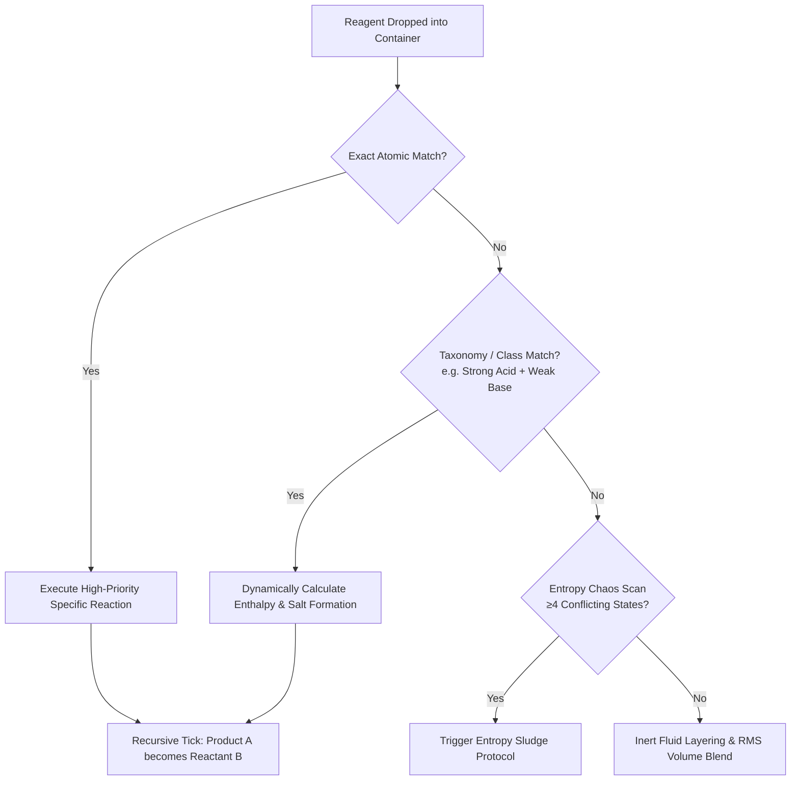

# Chemic-AI Ultimate: The Quantum Reality Chemistry Engine
### *A High-Performance "Safe-Failure" Virtual Laboratory & AI Mentor for Secondary Chemistry Education*

[](https://ai.google.dev/)
[](https://reactjs.org/)
[](https://vitejs.dev/)
[](https://tailwindcss.com/)
[](LICENSE)

> **#AIRiserVietnam** • **#BuildwithGoogleAI**  
> *Authored by [Ngô Minh Thiên Bảo (reukem)](https://github.com/reukem)*  
> **Repository:** [https://github.com/reukem/latest-Chemic-AI-Version](https://github.com/reukem/latest-Chemic-AI-Version)

---

## 🧪 1. The Theory-Practice Gap: Solving the Core "Pain Point"

In secondary education across Vietnam and developing regions, **Chemistry is often considered one of the most abstract and difficult subjects to master**. 

### 🛑 The Reality in Classrooms:
- **Passive Rote-Memorization (*"Học vẹt & Đọc chép"*):** Students are forced to memorize complex balance equations and reaction colors purely on paper without ever witnessing the physical phenomena.
- **Resource & Budget Constraints:** Many schools lack fully equipped, safe laboratory facilities or cannot afford costly single-use reagents (e.g., silver nitrate, anhydrous alkali metals).
- **Severe Safety Hazards:** Real-world laboratories carry inherent risks—corrosive acid burns, noxious gas emissions ($Cl_2$, $NO_2$), and explosive exothermic hazards—restricting physical hands-on experimentation to at most once or twice a year.

---

### 🚀 The "Safe-Failure" Philosophy:
**Chemic-AI is a 100% risk-free digital twin and interactive sandbox built to bridge this theory-practice gap.**

Instead of punishing mistakes, Chemic-AI embraces **Safe Failure**:
- Students are encouraged to mix wrong ratios, create violent alkali explosions, overload glassware, and trigger runaway exothermic cascades.
- Active trial-and-error builds deep, intuitive chemical intuition that passive textbook reading can never replicate.
- Zero burns, zero toxic fumes, and zero wasted chemicals.

```
       [ Traditional Learning ]                    [ Chemic-AI Safe-Failure Lab ]
  Textbook Formula -> Rote Memorize         Experiment -> Make Mistakes -> Observe Physics -> Master Concept
         (Passive & Fragile)                                 (Active & Intuitive)
```

---

## 💻 2. Advanced Mathematical & Visual Physics Engine

Chemic-AI abandons generic DOM clickers and static GIF animations in favor of custom, mathematically authentic simulation algorithms running at 60 FPS directly in the browser.

### 🎨 Root-Mean-Square (RMS) Optical Color Blending
Standard web applications use basic arithmetic averaging (Linear Interpolation) to mix colors. However, linear math completely violates real-world photon absorption and pigment subtractive mixing, resulting in dull, desaturated grey mud.

Chemic-AI utilizes **Root-Mean-Square (RMS)** mathematical algorithms weighted strictly by fluid volume ($V$):

$$R_{\text{mix}} = \sqrt{\frac{R_1^2 \cdot V_1 + R_2^2 \cdot V_2}{V_1 + V_2}}, \quad G_{\text{mix}} = \sqrt{\frac{G_1^2 \cdot V_1 + G_2^2 \cdot V_2}{V_1 + V_2}}, \quad B_{\text{mix}} = \sqrt{\frac{B_1^2 \cdot V_1 + B_2^2 \cdot V_2}{V_1 + V_2}}$$

$$\text{Alpha}_{\text{mix}} = \frac{\alpha_1 \cdot V_1 + \alpha_2 \cdot V_2}{V_1 + V_2}$$

* **Result:** Mixing an inert vivid Yellow (`#FDE047`) with an inert Blue (`#2563EB`) produces an authentic, vibrant Emerald Green rather than a washed-out greyish gradient.
* **Precipitate & Turbidity Modeling:** Simulates distinct solid suspension states ($AgCl$ white curd, $Fe(OH)_3$ red-brown gel, $Cu(OH)_2$ deep blue jelly) with variable opacity based on solubility constants ($K_{sp}$).

---

### ⚡ 3. V2.0 2D Canvas Engine: Democratizing Educational Tech
Rather than relying on resource-heavy 3D WebGL (Three.js) engines that drain battery and stutter on low-end hardware, **Chemic-AI V2.0 utilizes a hyper-optimized 2D Canvas + Vite architecture**:
- **Blender-Baked Photorealistic Assets:** Lab glassware, meniscus levels, and reagent bottles are pre-rendered from Blender with photorealistic lighting, caustics, and normal maps.
- **Extreme Accessibility:** Runs at smooth 60 FPS on budget smartphones and entry-level laptops over 3G/4G connections, ensuring students in remote or underserved areas enjoy the exact same high-fidelity lab experience.

---

### 💥 4. Additive Blending Particle VFX & Custom Pointer Physics
- **Exothermic Incandescence:** Chemical sparks, smoke plumes, and fiery combustions are rendered via a dedicated `requestAnimationFrame` canvas loop using **Additive Blending** (`ctx.globalCompositeOperation = 'lighter'`). Overlapping sparks mathematically sum RGB values to create authentic blinding white hotspots and optical bloom.
- **Rubber-Band Pointer Physics:** Native HTML5 Drag-and-Drop was discarded due to clunky mobile behavior. Chemic-AI features custom pointer raycasting (`pointerdown`, `pointermove`, `pointerup`) with Euclidean distance snapping to glassware necks.
- **Spatial Z-Index Clamping:** When explosive alerts or inspection modals are triggered, the engine instantly freezes raycasting coordinates, preserving state without dropping animation frames.

---

## ⚙️ 5. Kinetics, Thermodynamics & The "Sludge Protocol"

Chemic-AI does not use a rigid, hardcoded `if-else` list. It is driven by a dynamic **Chemical State Machine**:



### 🌪️ The "Entropy Sludge" Protocol:
What happens when a curious student dumps 10 incompatible reactive compounds into a single 100mL beaker?
- Instead of crashing or throwing JavaScript errors, the engine evaluates total container entropy.
- If $\ge 4$ conflicting reactive taxonomy classes are present without an energetic resolution path, the thermodynamic state collapses.
- The contents instantly convert into `ENTROPY_SLUDGE` with an unreactive murky brown hue (`#4A3B32`), mimicking real-world burnt, decomposed chemical waste.

---

## 🧬 6. Organic Molecular Sandbox (IUPAC Synthesizer)

Beyond inorganic beakers, Chemic-AI includes an **Interactive Organic Molecule Workbench**:
- **Modular Functional Groups:** Drag and snap Alkyl chains ($CH_3-$, $C_2H_5-$), Hydroxyl ($-OH$), Carboxyl ($-COOH$), Aldehydes ($-CHO$), and Aromatic Benzene rings ($C_6H_5-$).
- **Valence Rule Enforcement:** Atoms snap strictly according to carbon tetravalence ($C = 4$, $O = 2$, $N = 3$, $H = 1$).
- **30+ Organic Reaction Pathways:** Synthesize real-world organic transformations:
  - **Esterification:** $CH_3COOH + C_2H_5OH \xrightarrow{H_2SO_4, t^\circ} CH_3COOC_2H_5 + H_2O$ (Fruity aroma feedback)
  - **Tollens' Silver Mirror Test:** Aldehyde oxidation producing reflective silver coatings.
  - **Saponification & Polymerization:** Triglyceride lipid cleavage into glycerol and soap salts.

---

## 🧠 7. AI Mentor: Professor Lucy *(Powered by Gemini 2.5 Flash)*

Chemic-AI integrates an intelligent pedagogical co-pilot—**Giáo sư Lucy (Professor Lucy)**—engineered via `@google/genai`:

```
+-------------------------------------------------------------------------+
|                          BROWSER RUNTIME                                |
|  [Lab State Machine] ---> Serializes ---> [current_lab_state.json]      |
|                                                     |                   |
|  - Reactants & Volumes                              v                   |
|  - pH Level & Temperature                 Google Gemini 2.5 Flash       |
|  - Precipitate & Gas States                         |                   |
|                                                     v                   |
|  [Professor Lucy Chat / Warning UI] <--- Socratic Guidance & Explanations|
+-------------------------------------------------------------------------+
```

### Key Pedagogical Capabilities:
1. **Real-Time State Serialization:** The engine continuously serializes current beaker data (reactants, concentrations, temperature, pH, active precipitates) into JSON payloads sent to Gemini 2.5 Flash.
2. **Socratic Guidance:** Rather than giving away answers immediately, Lucy guides students step-by-step through reaction mechanisms, electron transfers, and Le Chatelier's equilibrium principles.
3. **Safety Interventions & Playful "Bonks":** Attempting to synthesize hazardous nerve agents, toxic $Cl_2$ gas clouds, or massive alkali explosions triggers Lucy's witty interventions and immediate safety debriefs.
4. **Multimodal Vision & Problem Scanner:** Students can upload photos of chemistry homework or national exam questions. Gemini Vision OCR parses the problem, balances the equation, and **auto-configures the virtual lab bench** with the required reagents and apparatus ready to simulate.
5. **Lucy Offline Knowledge Core:** If the user loses internet connection or runs in an offline rural classroom, the system seamlessly falls back to an embedded offline chemistry knowledge engine without breaking the user experience.

---

## 📚 8. Curriculum Alignment & National Exam Readiness (GDPT 2018)

- **179+ Interactive Curriculum Modules:** Fully mapped to the Vietnamese Ministry of Education (GDPT 2018) Chemistry standards across **Grades 8, 9, 10, 11, and 12**.
- **Bilingual Support (Tiếng Việt & English):** Seamless toggle between standard Vietnamese IUPAC terminology and international English chemical naming.
- **KaTeX / LaTeX Chemical Typography:** Pristine rendering of complex equations, redox electron half-reactions, and equilibrium states:
  $$\text{Fe}_3\text{O}_4 + 8\text{HCl} \longrightarrow \text{FeCl}_2 + 2\text{FeCl}_3 + 4\text{H}_2\text{O}$$
- **THPT National Exam Quests (Đề Thi THPT Quốc Gia):** High-yield exam puzzle scenarios challenging students to synthesize target substances, determine unknown ions, and calculate titration curves.
- **Competency Radar Analytics:** Automatically graphs student skill progression across Chemical Safety, Practical Experimentation, Reaction Kinetics, and Organic Nomenclature.

---

## 🔊 9. Procedural Audio Synthesis (Quantum Audio Gate)

Chemic-AI synthesizes realistic audio waveforms in real time using the **Web Audio API** instead of looping static audio files:
- **Dynamic Sine Oscillators & White Noise Filters:** Real-time generation of effervescent fizzing, liquid pouring resonance, and violent explosive booms proportional to enthalpy ($\Delta H$) and gas discharge rate.
- **Autoplay Compliance:** Audio context remains gracefully suspended until the user's initial interaction, unlocking crisp, synchronized feedback without UI stutter.

---

## 🛠️ 10. Local Development & Installation

### Prerequisites
- [Node.js](https://nodejs.org/) (version 18.0 or later)
- `npm` or `pnpm`

### Quick Start
```bash
# 1. Clone the repository
git clone https://github.com/reukem/latest-Chemic-AI-Version.git

# 2. Navigate to the project directory
cd latest-Chemic-AI-Version

# 3. Install dependencies
npm install

# 4. Start the high-speed local dev server
npm run dev

# 5. Build optimized production bundle
npm run build
```

### ⚡ Standalone 1-Click Offline Laboratory
Don't want to install Node.js? Download **`Chemic-AI Ultimate.html`** directly from the repository root or Releases page. Double-click to run the entire virtual laboratory, AI mentor, and analytical instruments offline in any modern web browser!

### Automated Testing Suite
Chemic-AI uses Playwright for comprehensive End-to-End simulation testing:
```bash
npx playwright test
```

---

## 🔮 11. Implemented Features & Future Roadmap

- [x] **20-Node Coupled 1D Shallow-Water Liquid Physics:** Real-time Hooke's Law surface wave propagation, capillary climb, and hydrodynamic particle swirling.
- [x] **Spectroscopy & Flame Test Simulator:** Real-time atomic emission spectral lines for qualitative cation analysis ($Na^+$ golden yellow, $K^+$ lilac, $Cu^{2+}$ green, $Ca^{2+}$ brick red, $Ba^{2+}$ apple green).
- [x] **3D Electron Orbital & VSEPR Visualizer:** Interactive nodal planes, molecular geometry, and orbital hybridization ($sp, sp^2, sp^3, d^2sp^3$).
- [x] **Galvanic Cell & Electrochemistry Simulator:** Daniell cell ($Zn/Cu$), SHE reference, real-time voltmeter readouts, and salt-bridge ion transport.
- [x] **Reaction Kinetics & Activation Energy Simulator:** Arrhenius temperature-rate curves, Maxwell-Boltzmann kinetic energy distributions, and reaction orders.
- [x] **Offline Lucy Pedagogical Neural Brain:** Zero-latency offline AI mentor with dual-language audio synthesis, volume sliders, and Socratic guidance.
- [ ] **Live2D Real-Time Voice Model:** Upgrading Professor Lucy with full lip-synced Live2D animations and bidirectional WebRTC voice streaming.

---

## 🌟 12. Vision: Democratizing Science Through "AI for Good"

> *"Chemic-AI was born from a simple belief: Every student, regardless of their school's financial resources or geographic location, deserves the right to touch, explore, and fall in love with scientific discovery.*
> 
> *By merging mathematically authentic graphics, deep pedagogical scaffolding, and Google Gemini AI, we turn abstract equations into living, breathing, safe-failure realities."*
> 
> — **Ngô Minh Thiên Bảo ([@reukem](https://github.com/reukem))**

---

<div align="center">

**[Chemic-AI Repository](https://github.com/reukem/latest-Chemic-AI-Version)** • Built with 💙 for the Future of Science Education.

</div>
